<div align="center">

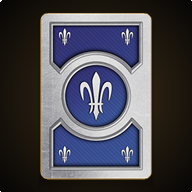

# Gwent Classic

**The Witcher 3 card game, rebuilt for the browser.**
<br>
A full story campaign, smart AI, online and pass-and-play matches, and the original soundtrack. Plain HTML, CSS and JavaScript with no build step.

<br>

[](https://witcher-gwent.vercel.app)


<br>

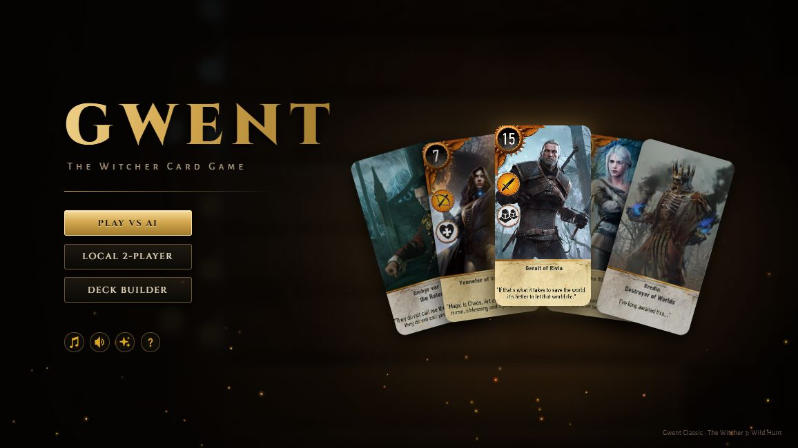

<br>

&nbsp;&nbsp;
&nbsp;&nbsp;
&nbsp;&nbsp;
&nbsp;&nbsp;


</div>

---

## Contents

<table>
<tr>
<td valign="top">

**Play**
- [Features](#-features)
- [Screenshots](#-screenshots)
- [Quick start](#-quick-start)
- [How to play](#-how-to-play)

</td>
<td valign="top">

**Modes**
- [Story mode](#-story-mode)
- [Vs AI](#-vs-ai)
- [Online](#-online)
- [Pass and play](#-pass-and-play)

</td>
<td valign="top">

**Reference**
- [Factions](#-factions)
- [Card abilities](#-card-abilities)
- [Deck building](#-deck-building)
- [Settings](#-settings)

</td>
<td valign="top">

**Project**
- [Architecture](#-architecture)
- [Development notes](#-development-notes)
- [Credits](#-credits)
- [License](#-license)

</td>
</tr>
</table>

---

## ✦ Features

<table>
<tr>
<td width="50%" valign="top">

### 🗺️ Story campaign
Follow Geralt across the Continent, from White Orchard to the Wild Hunt and on into *Hearts of Stone* and *Blood and Wine*. Narrated by Dandelion, with **42 opponents**, chapter bosses with their own rules, **3 tournaments**, a card collection, a shop, wagers and a guided tutorial.

</td>
<td width="50%" valign="top">

### 🃏 Every card
All **216 cards** and **22 leaders** from the base game, *Hearts of Stone*, *Blood and Wine* and the next-gen update, across five factions.

</td>
</tr>
<tr>
<td valign="top">

### 🤖 Four AI levels
Easy, Normal, Hard and Expert, each with its own deck pool. Hard plays for card advantage and plans the cheapest way to win a round.

</td>
<td valign="top">

### 🌐 Online and local
Peer-to-peer online matches with a room code or invite link, turn timers and deck rules, plus **pass-and-play** on one device with a privacy curtain between turns.

</td>
</tr>
<tr>
<td valign="top">

### 🎵 Official soundtrack
**24 tracks** from the TW3, *Hearts of Stone* and *Blood and Wine* soundtracks, loudness-normalized and crossfaded, with themes per chapter and per boss.

</td>
<td valign="top">

### 📱 Plays anywhere
Installable PWA with offline cache, 16:9 stage that scales to any screen, touch gestures, keyboard and screen-reader support, English and Spanish.

</td>
</tr>
</table>

---

## 🖼️ Screenshots

<table>
<tr>
<td align="center" width="50%">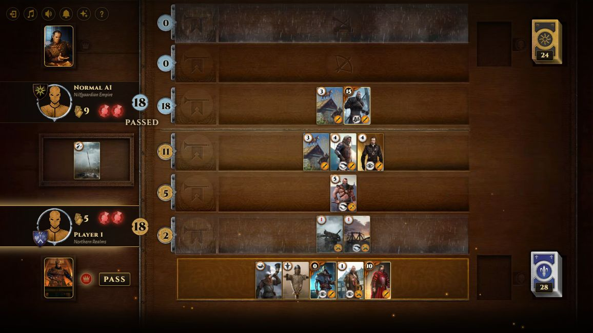<br><sub><b>The board</b>: rows, weather, leaders and score</sub></td>
<td align="center" width="50%">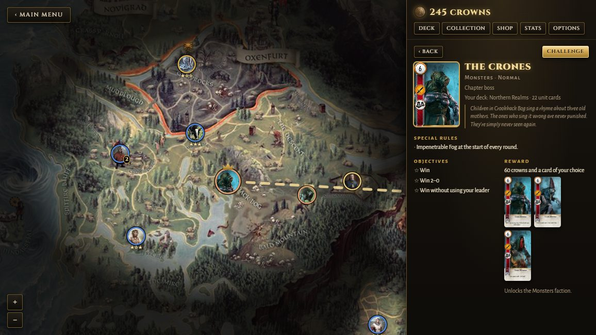<br><sub><b>Story map</b>: chapters, pins, fog and the journal</sub></td>
</tr>
<tr>
<td align="center">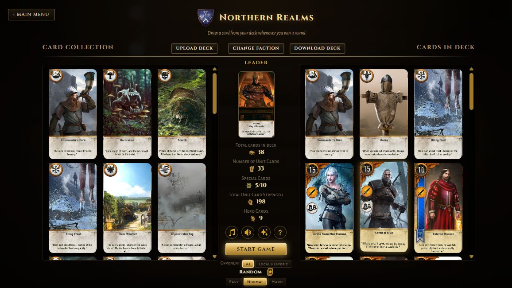<br><sub><b>Deck builder</b>: collection, deck and stats</sub></td>
<td align="center">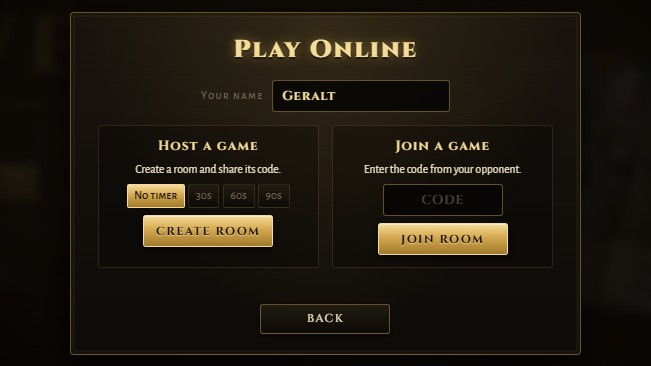<br><sub><b>Online lobby</b>: room codes, timers and deck rules</sub></td>
</tr>
<tr>
<td align="center">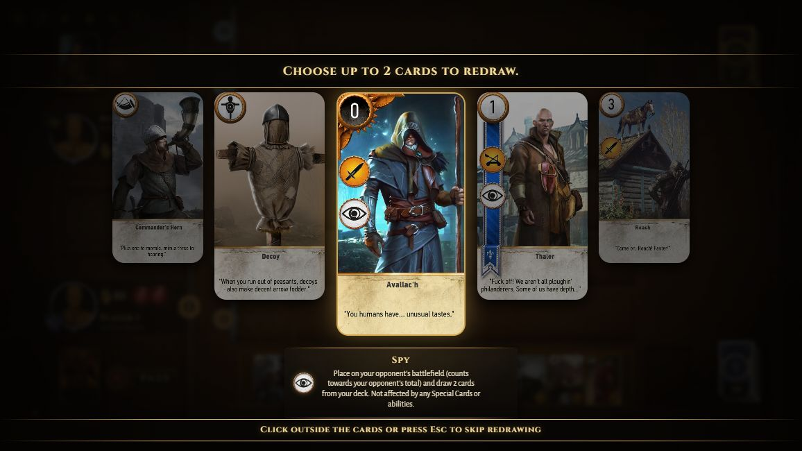<br><sub><b>Redraw</b>: swap up to 2 opening cards</sub></td>
<td align="center">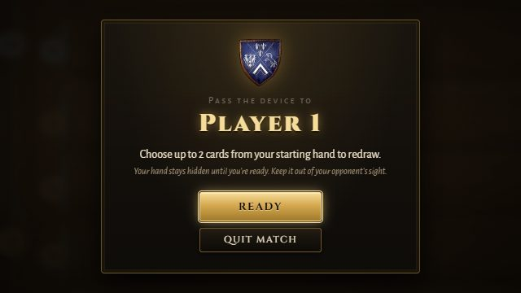<br><sub><b>Pass and play</b>: hand-off curtain</sub></td>
</tr>
</table>

---

## 🚀 Quick start

> [!TIP]
> The fastest way to play is the hosted version: **[witcher-gwent.vercel.app](https://witcher-gwent.vercel.app)**. On a phone, use **Install** on the title screen to add it as an app.

**Windows:** double-click **`Start Gwent.bat`**. It starts a local server at <http://127.0.0.1:8000/> and opens your browser. It uses Python (`py` or a real `python`, not the Microsoft Store shortcut) and falls back to Node.js (`npx http-server`). Close the server window to stop it.

**Any platform:**

```sh
python -m http.server 8000 --bind 127.0.0.1
# then open http://127.0.0.1:8000/
```

> [!NOTE]
> Opening `index.html` directly (`file://`) works, but some browsers then fail to load the music and larger sound effects. Use a local server.

Press <kbd>F11</kbd> for fullscreen. On phones the game goes fullscreen and landscape on the first tap.

---

## 📜 How to play


**Win two of three rounds.** The higher total score when a round ends wins it. Each player has two gems and loses one per round lost.

| Step | What happens |
| :---: | --- |
|  | **Coin toss** decides who goes first (Scoia'tael may choose). Passive leaders are announced with a banner. |
| 🔄 | **Redraw** up to 2 cards from your opening hand of 10. |
|  | **Your turn:** play one card, or click your **leader** to use its ability (once per match). |
|  | **Pass:** *hold* the Pass button (a quick tap does nothing). Your opponent keeps playing until they pass too. |
|  | **Next round:** the board is cleared. You **don't draw** between rounds, so card advantage matters. |

Units go in **Close Combat** , **Ranged**  or **Siege** . Click a card, then a row. Rows, discard piles and leaders can be inspected at any time, even on your opponent's turn.

<details>
<summary><b>⌨️ Keyboard and accessibility</b></summary>

<br>

| Key | Action |
| --- | --- |
| <kbd>Tab</kbd> | Move between cards, rows and buttons |
| <kbd>Enter</kbd> / <kbd>Space</kbd> | Activate the focused element (Pass passes immediately) |
| <kbd>←</kbd> <kbd>→</kbd> | Browse card pickers |
| <kbd>Enter</kbd> | Select in a card picker |
| <kbd>Esc</kbd> | Close a picker or cancel a selected card |

Game messages are announced to screen readers, and visual effects turn off when the OS asks for reduced motion. The **?** button opens an illustrated How to Play guide.

</details>

---

## 🗺️ Story mode

A single-player campaign through *The Witcher 3*, told by **Dandelion**. Choose **Story** on the title screen. You start with a weak Northern Realms deck and an empty purse, and build a collection by beating the people (and monsters) Geralt met along the way. Your first match, against the White Orchard innkeeper, is a **guided tutorial** (replay it any time from **Options**).

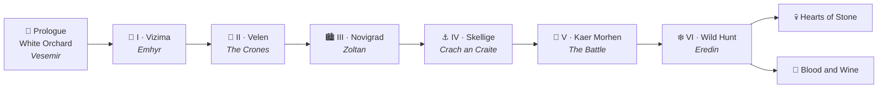

### Chapters

| | Chapter | Boss | Unlocks | Crowns per win |
| :---: | --- | --- | --- | :---: |
| 🌳 | **Prologue:** White Orchard | Vesemir | | 10 |
| 👑 | **I:** Vizima | Emhyr var Emreis |  Nilfgaard | 20 |
| 🌲 | **II:** Velen | The Crones |  Monsters | 30 |
| 🏙️ | **III:** Novigrad & Oxenfurt | Zoltan Chivay |  Scoia'tael, Passiflora tournament | 50 |
| ⚓ | **IV:** Skellige | Crach an Craite |  Skellige, Kaer Trolde tournament | 70 |
| 🏰 | **V:** Kaer Morhen | Battle of Kaer Morhen | | 85 |
| ❄️ | **VI:** The Wild Hunt | Eredin Bréacc Glas | Credits, post-game chapters | 100 |
| 💀 | *Hearts of Stone* (post-game) | | A secret opponent | 100 |
| 🍷 | *Blood and Wine* (post-game) | | Beauclair tournament | 100 |

A boss appears once you've beaten the chapter's key opponents and enough of the others; beating it opens the next chapter. The Wild Hunt is linear: each general must fall before the next. Kaer Morhen's valley also hides three optional monster fights.

### The map

- **Pins** are opponents or places with several (number on the pin). Pulsing = ready, 👑 = boss, 🔒 = locked, ★ under a pin = stars earned.
- Unreached regions are covered in **fog**; a dotted route links the bosses you've opened.
- Zoom with the wheel, a pinch or **+**/**−**, and drag to pan. A sharper map loads when you zoom in on large screens.
- The side panel opens on the **Journal**: chapters, progress, stars, tavern rumors, open tournaments and **Replay Story**.
- The top bar shows your **crowns** and opens **Deck**, **Collection**, **Shop**, **Stats** and **Options**.

### Opponents, rules and stars

Each opponent shows their faction, AI level (Easy in White Orchard up to Expert for the final bosses), **special rules**, **objectives** and **reward**. Press **Challenge**; Dandelion tells how it went afterwards.

<details>
<summary><b>⚔️ Special rules</b></summary>

<br>

| Rule | Effect |
| --- | --- |
| Weather | A weather card is played at the start of some or every round |
| Ambush | Your opponent goes first |
| Extra draw | You (or both players) draw an extra card in round 1 |
| Informants | You discard a random card in round 1 |
| Leader blocked | Your leader is blocked for the whole match |
| Terms | Deck restrictions (e.g. no weather); **Challenge** stays disabled until your deck complies |
| Children of the Frost | The opponent's close combat row ignores Biting Frost |
| White Frost | Weather halves the strength of your heroes |
| Hero taken | One random hero is removed from your deck for the match |
| Hero limit | Only one hero per round |
| Scorch heroes | Scorch can destroy your heroes |
| Hero debt | Each hero you play makes you discard a random card |
| Hero feeds | Each hero you play gives the opponent's units +1 for the round |

</details>

**Stars:** ★ for winning plus ★★ for the opponent's two objectives:

<table>
<tr>
<td>Win 2–0</td><td>Win without using your leader</td><td>Win the final round by 20+</td>
</tr>
<tr>
<td>Finish with 3+ cards in hand</td><td>Win without playing weather</td><td>Win while going second</td>
</tr>
</table>

Earn all three and a **secret fourth star** appears: *win without playing a hero*. Collect all four stars on **every** opponent (side and secret ones included) to become a **Gwent Master**: every missing card is added to your collection, and a star badge appears next to your name in story, vs AI and online matches.

Losing costs nothing: adjust your deck and try again. Leaving a match early counts as a loss.

### Rewards and the collection

| | |
| --- | --- |
| 💰 **Crowns** | The chapter's rate per win. Bosses pay double the first time, rematches pay half, and each new star adds a quarter of the rate. |
| 🎴 **Cards** | Pick 1 of 3 after every win. First wins also give the opponent's fixed reward cards. Copies beyond a card's limit pay out half their shop price. |
| 🃏 **Deck** | The deck builder, limited to the cards and leaders you own; one deck per unlocked faction. |
| 📚 **Collection** | Every card by faction with owned/maximum copies. |
| 🛒 **Shop** | 8 cards from your factions plus neutral, special and weather cards; restocks every 3 matches. **20** plain units · **60** ability cards · **250** heroes. |
| 🎲 **Wagers** | On rematches and tournament rounds, stake 10, 25 or 50 crowns (win doubles) or a spare card (win to keep it and take one from the opponent's deck). |
| 📊 **Stats** | Wins, losses, streaks, crowns earned, tournaments won, stars and collection per faction. |

### Tournaments

| Tournament | Opens after | Entry | Per round | Champion |
| --- | --- | :---: | :---: | --- |
| 🌸 **Passiflora** (Novigrad) | Zoltan | 20 | 20 | +80 and a leader card |
| ⚓ **Kaer Trolde** (Skellige) | Crach | 50 | 50 | +200 and a leader card |
| 🍷 **Beauclair** (Toussaint) | Regis | 100 | 100 | +400 and a leader card |

Three single-elimination rounds against random entrants, each tougher than the last. The bracket is fixed when you enter, so a reload resumes the run. A draw replays the round; a loss ends the run. Once you own all of a tournament's leaders, the champion picks a hero instead.

### Saving

Progress saves automatically in `localStorage` (`gc-story`). **Options** exports the save as `gwent-story-save.json`, imports it on another device, or resets the campaign. Invalid saves are kept in `gc-story-backup` before a fresh one starts.

---

## 🤖 Vs AI

Choose **Local Play** on the title screen, keep **AI** under *Opponent*, and pick a difficulty.

| Level | Decks | Play style | Your deck cap |
| --- | --- | --- | --- |
| 🟢 **Easy** | Weak starter decks | Skips its redraw, often plays randomly | |
| 🟡 **Normal** | The classic premade decks | Weighs options with some randomness | |
| 🟠 **Hard** | Thin decks full of heroes, spies and medics | Takes free cards first, answers with the cheapest card that takes the lead, wins with the fewest cards | 180 strength, 4 heroes |
| 🔴 **Expert** | Hard decks | Hard AI | 130 strength, 3 heroes |

Pick your **avatar** by clicking your portrait on the board: 28 character portraits from the official goodie pack.

---

## 🌐 Online

1. Choose **Online** and enter a name.
2. The host picks a **turn timer** (none, 30, 60 or 90 s) and optional **deck rules** (Expert limits, No Heroes, No Neutrals, No Specials, No Weather), then presses **Create Room**.
3. Share the 5-character **room code**, or **Share Invite Link**.
4. The guest enters the code and presses **Join Room**. Both pick a deck and press **Ready**.

After the match: **Rematch** (both accept), **New Game** (back to the deck builder) or **Main Menu**. Dropped connections retry for 60 seconds, and reloading mid-match rejoins automatically.

<details>
<summary><b>🔧 How it works</b></summary>

<br>

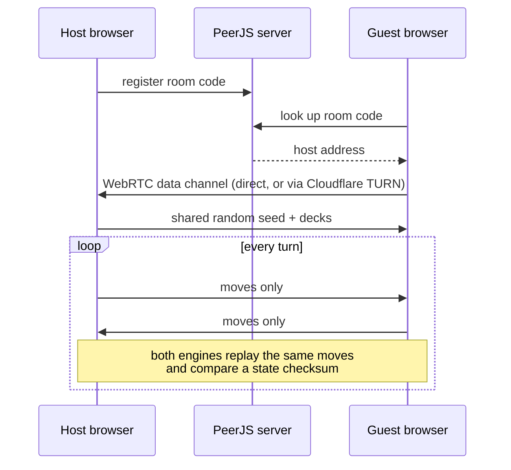

- Browsers connect directly with WebRTC via [PeerJS](https://peerjs.com/); its public server is only used to find each other.
- When a direct link isn't possible (strict NATs, mobile data), traffic goes through a **Cloudflare TURN** relay. `api/turn.js` (a Vercel function) hands out 6-hour credentials to the game's own site only.
- Both clients run the same game from a shared seed and exchange only their moves. If the checksums ever disagree, or a move breaks the rules, the match ends.

</details>

---

## 👥 Pass and play

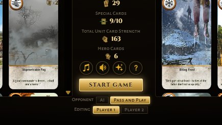

Two players, one device.

1. **Local Play** → **Pass and Play** under *Opponent*.
2. Use **Editing: Player 1 / Player 2** to build each player's deck (saved separately).
3. Press **Start game**.

Player 1 plays the bottom half, Player 2 the top. A **Pass the device** curtain hides the board whenever control changes hands, so nobody sees the other's cards. Banners and the end screen name the player ("Player 2's turn").

<br clear="right">

---

## 🛡️ Factions

| | Faction | Perk |
| :---: | --- | --- |
|  | **Northern Realms** | Draw a card whenever you win a round. |
|  | **Nilfgaardian Empire** | Wins any round that ends in a draw. |
|  | **Monsters** | Keeps a random unit on the board after each round. |
|  | **Scoia'tael** | Decides who takes the first turn. |
|  | **Skellige** | 2 random units from the graveyard return at the start of round 3. |

Each faction has several leaders. Most are used once per match by clicking the leader; a few are passive and work from the start. The White Flame blocks the opponent's leader.

---

## ✨ Card abilities

<table>
<tr>
<td align="center" width="64"></td>
<td><b>Hero</b><br><sub>Immune to weather, special cards and abilities.</sub></td>
<td align="center" width="64"></td>
<td><b>Agile</b><br><sub>Close Combat or Ranged.</sub></td>
</tr>
<tr>
<td align="center"></td>
<td><b>Medic</b><br><sub>Revive a unit from your discard pile (not heroes).</sub></td>
<td align="center"></td>
<td><b>Morale Boost</b><br><sub>+1 to every other unit in its row.</sub></td>
</tr>
<tr>
<td align="center"></td>
<td><b>Muster</b><br><sub>Summons all copies of the same card from your deck.</sub></td>
<td align="center"></td>
<td><b>Spy</b><br><sub>Played on the opponent's side; you draw 2 cards.</sub></td>
</tr>
<tr>
<td align="center"></td>
<td><b>Tight Bond</b><br><sub>Strength multiplied by copies of the same card in its row.</sub></td>
<td align="center"></td>
<td><b>Scorch</b><br><sub>Destroys the strongest card(s) on the board, or in an enemy row.</sub></td>
</tr>
<tr>
<td align="center"></td>
<td><b>Commander's Horn</b><br><sub>Doubles the strength of a row (one per row).</sub></td>
<td align="center"></td>
<td><b>Decoy</b><br><sub>Swap with a unit to return it to your hand.</sub></td>
</tr>
<tr>
<td align="center"></td>
<td><b>Berserker</b><br><sub>Transformed by Mardroeme into a stronger bear.</sub></td>
<td align="center"></td>
<td><b>Mardroeme</b><br><sub>Triggers Berserkers in its row.</sub></td>
</tr>
<tr>
<td align="center"></td>
<td><b>Avenger</b><br><sub>Summons another card when removed from the board.</sub></td>
<td align="center"></td>
<td><b>Clear Weather</b><br><sub>Removes all weather effects.</sub></td>
</tr>
<tr>
<td align="center"></td>
<td><b>Biting Frost</b><br><sub>Close Combat units drop to 1.</sub></td>
<td align="center"></td>
<td><b>Impenetrable Fog</b><br><sub>Ranged units drop to 1.</sub></td>
</tr>
<tr>
<td align="center"></td>
<td><b>Torrential Rain</b><br><sub>Siege units drop to 1.</sub></td>
<td align="center"></td>
<td><b>Skellige Storm</b><br><sub>Fog and Rain together.</sub></td>
</tr>
</table>

---

## 🃏 Deck building


Open the **Deck Builder** from the title screen.

- Pick a faction, then click cards in the collection (left) and deck (right) to move them.
- Click your leader to cycle through that faction's leaders.
- A deck needs **≥ 22 unit cards** and **≤ 10 special cards**; the stats column turns red when a limit is broken.
- Decks are saved per faction in `localStorage` (separately for Player 2). Story mode keeps its own decks and collection.

<details>
<summary><b>📄 Deck format</b></summary>

<br>

`index` is the card's position in `card_dict` (`cards.js`):

```json
{ "faction": "realms", "leader": 0, "cards": [[index, count], ...] }
```

Factions: `realms`, `nilfgaard`, `monsters`, `scoiatael`, `skellige`.

</details>

<br clear="right">

---

## ⚙️ Settings

The round buttons sit in the deck builder's center column and in the top-left corner of the board during a match. Everything is remembered between sessions.

| | Setting | Notes |
| :---: | --- | --- |
|  | **Music** | 24 official tracks, loudness-normalized to −18 LUFS and crossfaded. Kaer Morhen plays in menus; each story chapter and boss has its own theme; matches rotate *Gwent*, *Drink Up, There's More!* and *The Nightingale*. Tracks stream on first play. |
|  | **Sound effects** | Card placement, abilities, weather, results and menus. |
|  | **Game messages** | Banners for coin toss, turns, passes, rounds and faction perks. |
|  | **Visual effects** | Particle bursts, screen shake, sunlight, score pulses and card flips. Off automatically with reduced motion. |
| 🌍 | **EN / ES** | Title screen language switch (story dialogue included; card names stay in English). |

During a match the game keeps the screen awake on phones that support it.

---

## 🏗️ Architecture

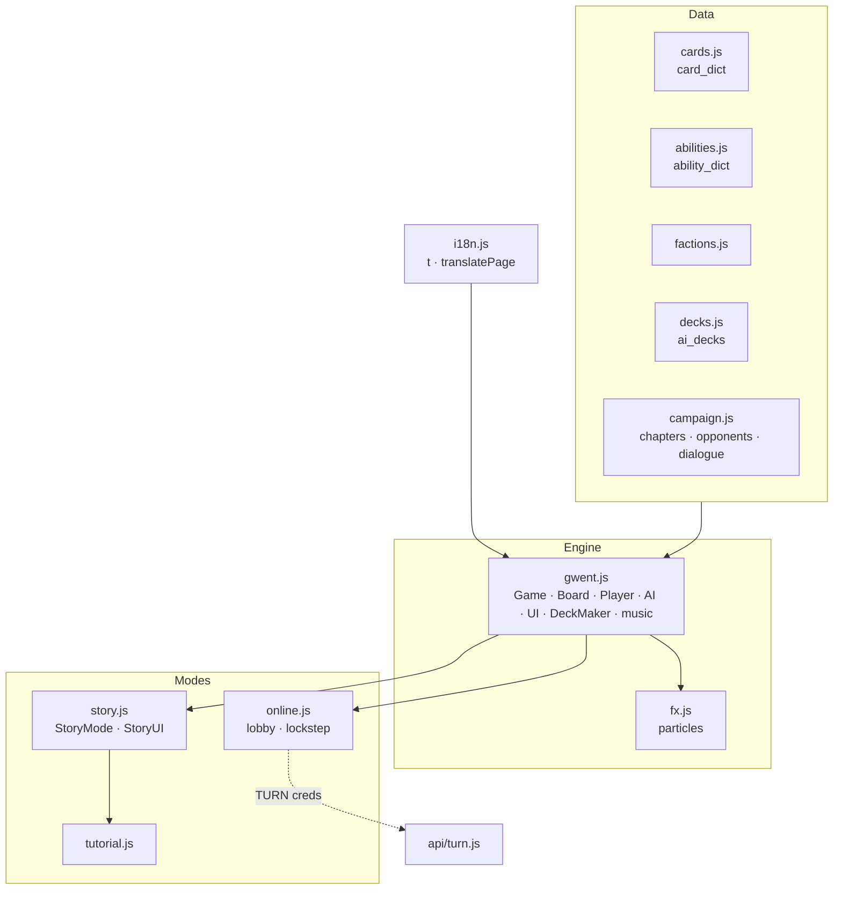

<details>
<summary><b>📁 Project structure</b></summary>

<br>

| Path | Contents |
| --- | --- |
| `index.html` | Markup: title screen, board, deck builder, guide, story screen, script/style includes |
| `i18n.js` | Spanish translations (`t()`, `translatePage()`), loaded first |
| `gwent.js` | Engine: board, rows, players, AI, pass and play, UI, deck builder, guide, settings, audio, music, avatars |
| `online.js` | Lobby, PeerJS connection, lockstep move exchange, reconnects, turn timer |
| `campaign.js` | Story data: starters, places, chapters, opponents, tournaments, dialogue (EN/ES) |
| `story.js` | `StoryMode` (save, collection, progression, rewards, shop, wagers, tournaments) and `StoryUI` (map, panel, dialogue, modals) |
| `tutorial.js` | `StoryTutorial`: the guided first story match |
| `portrait-frames.js` | Crop and zoom of card art for round story portraits |
| `cards.js` · `abilities.js` · `factions.js` · `decks.js` | Card database, abilities, faction perks, AI decks |
| `fx.js` | Visual effects (`fx.burst`, `fx.shake`, `fx.sunlight`, `fx.pulse`, `fx.flash`) |
| `common.js` | Shared helpers |
| `api/turn.js` | Vercel function minting Cloudflare TURN credentials (`CF_TURN_KEY_ID`, `CF_TURN_API_TOKEN`) |
| `lib/peerjs.min.js` | PeerJS 1.5.5 (MIT), lazy-loaded for online play |
| `sw.js` · `manifest.webmanifest` | Service worker (offline cache) and web app manifest |
| `css/` | `tokens`, `base`, `board`, `cards`, `overlays`, `deckbuilder`, `title`, `fx`, `guide`, `story` |
| `img/` | Board, card art (`sm/`, `lg/`), icons, avatars, app icons, guide screenshots, story map |
| `svg/` | UI button icons |
| `sfx/` | Sound effects and music (`sfx/music/`) |
| `tools/portrait-framer.html` | Visual editor for `portrait-frames.js` (not deployed) |
| `Start Gwent.bat` | Local server launcher for Windows |

</details>

---

## 🛠️ Development notes

> [!IMPORTANT]
> No build tooling: edit a file and reload. Serve over http when testing audio.

<details>
<summary><b>Conventions and gotchas</b></summary>

<br>

- **Sizing:** the stage is a letterboxed 16:9 box. `var(--u)` = 1% of stage width; use it instead of `vw`.
- **Board art:** row positions and score circles are baked into `img/board.jpg`. Restyle overlays, don't move them.
- **Card transforms:** `gwent.js` sets an inline `transform` while moving cards, so CSS animations on cards use standalone `translate` / `scale` / `rotate`.
- **Script order:** `i18n.js` first; `online.js`, `campaign.js`, `portrait-frames.js`, `story.js`, `tutorial.js` and `fx.js` after `gwent.js`. New shell files go in `sw.js`; bump its `VERSION` when replacing assets in place.
- **Async flows:** capture `game.session` before awaiting and bail if it changed, or a quit mid-turn leaks into the next game.
- **Online determinism:** game randomness uses the seeded `player.rng` (or `Online.rng` for the coin toss); random picks from containers sort by `card.uid` first. Player choices go through `Online.carousel` / `rowChoice` / `choice`.
- **Summons and resets:** abilities that put cards on the board from a `removed` callback must check `game.summonsAllowed()`.
- **Off-turn input:** rows, weather, graves and leaders stay inspectable while `main.noclick` is set; anything that plays a card must check `ui.isInteractive()`.
- **Story matches:** `Game.startGame` calls `StoryMode.applyModifiers` before setting up players; end screen, exit and rematch hand off to `StoryMode`.
- **Campaign data:** cards are `[card_dict index, count]`; pins and fog reveals are percentages of the map. Dialogue lines are `{who, en, es}` with `who` = `opp`, `geralt`, `ciri`, `narrator` (Dandelion) or `chronicle`.
- **Story saves:** `StoryMode.sanitize()` rebuilds saves from known fields only; add new fields there.
- **Music:** new tracks must be MPEG-1 Layer III (32/44.1/48 kHz) and normalized to −18 LUFS.

</details>

---

## 🙏 Credits

- Original project by [asundr](https://github.com/asundr/gwent-classic).
- Many sound effects from [RandomPianist's gwent-classic-v3.1](https://github.com/RandomPianist/gwent-classic-v3.1).
- Music, avatars and the story map from the official *The Witcher 3: Wild Hunt* soundtracks and goodie pack (composers include Marcin Przybyłowicz and Mikolai Stroinski).
- Gwent, The Witcher and all related art and music are property of **CD PROJEKT RED**. This is a non-commercial fan project.

## 📄 License

Released under the [LICENSE](LICENSE), which includes the **Commons Clause**: the software may not be sold.

<div align="center">

<br>


<sub><i>"Wind's howling."</i></sub>

</div>
